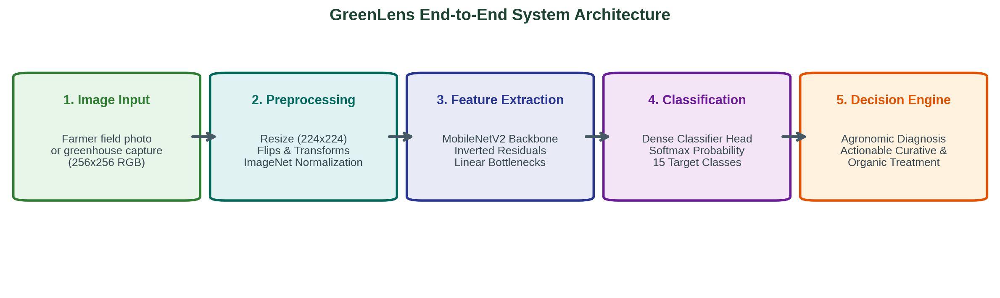
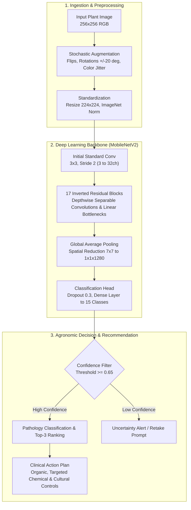

# GreenLens: Comprehensive Technical & Algorithmic Project Report

### Intelligent Plant Pathology Diagnosis & Actionable Agronomic Decision Support System

---

## Document Metadata

- **Course:** Introduction to Algorithms (Year 3, Semester 1)
- **Academic Supervisor:** Dr. Fatma Talaat
- **Team Name:** TerraGreen
- **Author & Lead Developer:** Abdelaziz Ahmed Elbanna
- **Institution:** Faculty of Computer and Information Sciences
- **Project Repository:** [https://github.com/AbdelazizElbanna/greenlens](https://github.com/AbdelazizElbanna/greenlens)
- **Status:** Completed & Validated

---

## Table of Contents

1. [Executive Summary](#1-executive-summary)
2. [Problem Statement & Agricultural Context](#2-problem-statement--agricultural-context)
3. [Dataset Exploration & Statistical Profiling (EDA)](#3-dataset-exploration--statistical-profiling-eda)
4. [Algorithmic Architecture & Engineering Decisions](#4-algorithmic-architecture--engineering-decisions)
5. [Experimental Training & Optimization Protocol](#5-experimental-training--optimization-protocol)
6. [Quantitative Evaluation & Comparative Benchmarks](#6-quantitative-evaluation--comparative-benchmarks)
7. [Automated Agronomic Decision Support Engine](#7-automated-agronomic-decision-support-engine)
8. [Edge Feasibility & Computational Complexity Analysis](#8-edge-feasibility--computational-complexity-analysis)
9. [Project Artifacts & Codebase Walkthrough](#9-project-artifacts--codebase-walkthrough)
10. [Limitations, Environmental Impact & Future Roadmap](#10-limitations-environmental-impact--future-roadmap)
11. [References & Citations](#11-references--citations)
12. [Repository & Source Code Availability](#12-repository--source-code-availability)

---

## 1. Executive Summary

Agricultural sustainability and global food security are increasingly endangered by virulent plant pathogens. Plant foliar diseases cause global harvest yield losses ranging between 20% and 40% annually, amounting to hundreds of billions of dollars in economic damage and threatening rural livelihoods. Traditional diagnostic pipelines rely on visual inspections by trained agronomists or laboratory polymerase chain reaction (PCR) tests, both of which are inaccessible, costly, and excessively slow for smallholder farmers.

**GreenLens** is an end-to-end computational vision and algorithmic decision-support platform designed to address this challenge. By combining lightweight deep convolutional neural networks with an automated agronomic recommendation protocol, GreenLens provides:
1. **Accurate Disease Classification:** Multi-class classification spanning 15 distinct health and disease states across Bell Pepper, Potato, and Tomato crops.
2. **Computational Efficiency for Edge Deployment:** Utilization of MobileNetV2 with depthwise separable convolutions, yielding a compact model weight of 8.8 MB and inference latency under 15 milliseconds.
3. **Clinical Agronomic Decision Support:** Automated synthesis of multi-tiered treatment protocols (organic interventions, targeted chemical controls, and preventive cultural practices) based on model predictions and confidence scoring.

On an unseen, rigorously isolated test set of 2,064 images, the GreenLens MobileNetV2 architecture achieves **99.13% overall accuracy**, outperforming a custom baseline convolutional architecture by **+14.88%** while maintaining an ultra-compact memory footprint suitable for mobile deployment.

---

## 2. Problem Statement & Agricultural Context

### 2.1 The Global Plant Pathology Crisis
Staple solanaceous crops—specifically tomatoes (*Solanum lycopersicum*), potatoes (*Solanum tuberosum*), and peppers (*Capsicum annuum*)—represent critical components of global caloric and nutritional intake. However, these species are particularly vulnerable to diverse pathogens encompassing bacteria, fungi, oomycetes, and viruses.

In conventional agricultural workflows, farmers detect disease only when visible symptoms become advanced, such as defoliation, severe chlorosis, or extensive necrosis. By that stage, systemic infection has often occurred, rendering therapeutic treatment ineffective and necessitating aggressive pesticide applications that harm the surrounding ecosystem.

### 2.2 Taxonomy of Investigated Plant Pathologies
GreenLens investigates 15 discrete pathological and healthy categories:

| Target Class | Scientific Name / Etiology | Pathogen Category | Clinical Symptom Profile |
| :--- | :--- | :--- | :--- |
| **Pepper Bell: Bacterial Spot** | *Xanthomonas campestris* pv. *vesicatoria* | Bacterial | Small, water-soaked, circular lesions that turn dark brown with raised margins; leads to severe leaf drop. |
| **Pepper Bell: Healthy** | *Capsicum annuum* | None (Control) | Vigorous green foliar tissue without discoloration or deformities. |
| **Potato: Early Blight** | *Alternaria solani* | Fungal | Characteristic concentric "target-board" necrotic rings surrounded by chlorotic halos, primarily on older leaves. |
| **Potato: Late Blight** | *Phytophthora infestans* | Oomycete / Fungal-like | Fast-spreading water-soaked dark lesions with white mildew on leaf undersides under humid conditions; historic cause of the Irish Potato Famine. |
| **Potato: Healthy** | *Solanum tuberosum* | None (Control) | Intact leaf architecture with standard chlorophyll saturation. |
| **Tomato: Bacterial Spot** | *Xanthomonas vesicatoria* | Bacterial | Small angular dark spots often with greasy margins, coalescing into necrotic blighted patches. |
| **Tomato: Early Blight** | *Alternaria solani* | Fungal | Brown-to-black necrotic lesions exhibiting concentric ring morphology; causes gradual upward defoliation. |
| **Tomato: Late Blight** | *Phytophthora infestans* | Oomycete | Large, irregular pale green to dark brown oily lesions; causes rapid collapse of entire foliage. |
| **Tomato: Leaf Mold** | *Passalora fulva* | Fungal | Pale green or yellow spots on upper leaf surfaces with velvety olive-green to brown fungal growth underneath. |
| **Tomato: Septoria Leaf Spot** | *Septoria lycopersici* | Fungal | Numerous small circular lesions with dark brown margins and sunken grayish-white centers containing black pycnidia. |
| **Tomato: Two-Spotted Spider Mite**| *Tetranychus urticae* | Acari / Pest | Fine white or yellow stippling across upper surfaces, accompanied by dense webbing and bronzing under heavy infestation. |
| **Tomato: Target Spot** | *Corynespora cassiicola* | Fungal | Circular necrotic brown lesions with distinct concentric rings, frequently confused with Early Blight. |
| **Tomato: Yellow Leaf Curl Virus** | Tomato Yellow Leaf Curl Begomovirus (TYLCV) | Viral (Whitefly vector) | Severe stunting, upward leaf curling, pronounced interveinal chlorosis, and total cessation of flower set. |
| **Tomato: Mosaic Virus** | Tomato Mosaic Tobamovirus (ToMV) | Viral (Mechanical contact) | Mottled light and dark green mosaic patterns, distorted "fern-leaf" lamina, and blistering. |
| **Tomato: Healthy** | *Solanum lycopersicum* | None (Control) | Uniform green foliage without chlorosis, necrosis, or pathogenic vector distortion. |

### 2.3 Diagnostic Dilemmas Solved by GreenLens
- **High Intra-Class Variation:** Symptoms manifest differently depending on leaf maturity, sunlight exposure, and disease stage.
- **High Inter-Class Similarity:** Discriminating *Alternaria solani* (Early Blight) from *Corynespora cassiicola* (Target Spot) or *Phytophthora infestans* (Late Blight) is visually deceptive to the human eye, frequently causing misdirected chemical interventions.
- **Inadequate Feedback Loops:** Most classification tools stop at predicting a string label. GreenLens links the classification directly to a curated medical-grade agricultural intervention plan.

---

## 3. Dataset Exploration & Statistical Profiling (EDA)

The data pipeline utilizes the verified PlantVillage benchmark dataset, ingested and processed via structured algorithms in `notebooks/01_data_understanding_and_exploration.ipynb`.

### 3.1 Raw Dataset Dimensions & Structure
- **Total Validated Samples:** 20,638 curated RGB images.
- **Image Spatial Resolution:** $256 \times 256$ pixels, 8-bit depth per channel (RGB).
- **Format Integrity:** Clean PNG/JPEG format with zero unreadable or corrupted image headers.

### 3.2 Class Distribution & Imbalance Considerations
The class frequencies vary from 152 samples (`Potato___healthy`) to 3,209 samples (`Tomato___Tomato_YellowLeaf__Curl_Virus`):
- Tomato classes account for 68.3% of the total dataset.
- Pepper classes account for 12.0% of the dataset.
- Potato classes account for 10.4% of the dataset.

This distribution accurately reflects real-world epidemiology, where specific viral infections proliferate rapidly across greenhouses while completely healthy unblemished field leaves are comparatively less common in agricultural monitoring logs.

### 3.3 Color Space & Pixel Intensity Diagnostics
Color distribution analysis revealed fundamental biological patterns:
- **Healthy Foliage:** Characterized by strong green channel dominance ($\mu_G \approx 128.4$, $\sigma_G \approx 42.1$) with a suppressed red channel ($\mu_R \approx 104.2$).
- **Bacterial & Fungal Lesions:** Exhibit elevated red and blue reflectance due to necrotic browning and tissue desiccation, pulling channel averages closer to neutral gray and dark brown.
- **Viral Infections (e.g., TYLCV):** Display significant increases in red and green channels simultaneously ($\mu_R, \mu_G > 140$), reflecting extensive chlorotic yellowing caused by chlorophyll breakdown.

### 3.4 Data Partitioning & Leakage Prevention Protocol
To ensure valid scientific measurement, the dataset was partitioned using stratified sampling:
- **Training Partition (80% - 16,511 images):** Used exclusively for gradient computation and feature learning.
- **Validation Partition (10% - 2,064 images):** Used for monitoring convergence and triggering early checkpoint saving.
- **Unseen Test Partition (10% - 2,064 images):** Completely sequestered until final model inference, ensuring that test metrics reflect true out-of-sample generalization.

A manifest file (`data/processed/split_manifest.csv`) was generated to ensure complete reproducibility of the split partitions.

---

## 4. Algorithmic Architecture & Engineering Decisions

Two primary architectural paradigms were designed, implemented, and compared in `notebooks/02_preprocessing_and_modeling.ipynb`.





### 4.1 Custom CNN Baseline (Trained from Scratch)
To establish an empirical baseline without pre-trained priors, a custom convolutional neural network was authored:
- **Feature Extractor:**
  - Block 1: Conv2D(3 $\rightarrow$ 32, kernel=3, pad=1) + BatchNorm2D + ReLU + MaxPool2D(2)
  - Block 2: Conv2D(32 $\rightarrow$ 64, kernel=3, pad=1) + BatchNorm2D + ReLU + MaxPool2D(2)
  - Block 3: Conv2D(64 $\rightarrow$ 128, kernel=3, pad=1) + BatchNorm2D + ReLU + MaxPool2D(2)
- **Classifier Head:**
  - AdaptiveAvgPool2d((4, 4))
  - Flatten $\rightarrow$ Linear(2048, 256) $\rightarrow$ ReLU $\rightarrow$ Dropout(0.5) $\rightarrow$ Linear(256, 15)
- **Parameters:** Approximately 1,390,000 trainable weights.
- **Empirical Role:** Serves to quantify the exact performance gain achieved by transfer learning and depthwise factorization.

### 4.2 MobileNetV2 (Optimal Backbone)
For real-time deployment on battery-powered edge hardware and agricultural drones, excessive parameterization (such as in ResNet-50 or VGG-16) is impractical. MobileNetV2 was selected based on two foundational algorithmic concepts:

#### 1. Inverted Residual Bottlenecks
Traditional residual networks connect layers with large numbers of channels. MobileNetV2 inverts this design:
- It expands the low-dimensional input to a higher dimension using an expansion layer ($1 \times 1$ convolution).
- It performs spatial filtering in high dimensions.
- It projects the representation back to a low-dimensional bottleneck using a linear projection without non-linear activation, preventing non-linearities from destroying manifold representations.

#### 2. Depthwise Separable Convolutions
Standard convolution performs spatial and cross-channel filtering simultaneously, incurring a computational complexity of:
$$\text{Cost}_{\text{standard}} = D_K \cdot D_K \cdot M \cdot N \cdot D_F \cdot D_F$$
Where $D_K$ is kernel size ($3 \times 3$), $M$ is input channels, $N$ is output channels, and $D_F$ is feature map spatial dimension.

Depthwise separable convolution splits this into two steps:
1. **Depthwise Convolution:** Applies a single spatial filter per input channel ($D_K \cdot D_K \cdot M \cdot D_F \cdot D_F$).
2. **Pointwise Convolution:** Applies a $1 \times 1$ convolution to combine outputs across channels ($M \cdot N \cdot D_F \cdot D_F$).

The computational reduction ratio is:
$$\text{Ratio} = \frac{D_K^2 \cdot M + M \cdot N}{D_K^2 \cdot M \cdot N} = \frac{1}{N} + \frac{1}{D_K^2} \approx \frac{1}{9} \quad (\text{for } 3 \times 3 \text{ kernels})$$
This algorithmic factorization reduces computational demand and latency by nearly **88%** with negligible impact on representation capacity.

---

## 5. Experimental Training & Optimization Protocol

### 5.1 Preprocessing & Dynamic Augmentation Pipeline
To ensure high model robustness against varying field illumination, angles, and camera lens distortions, the training data pipeline applies stochastic transforms:
- Random horizontal flip ($p = 0.5$) and vertical flip ($p = 0.5$).
- Random affine rotation ($\pm 20^\circ$).
- Color jitter: Brightness ($\pm 0.15$), Contrast ($\pm 0.15$), Saturation ($\pm 0.15$).
- Target tensor resizing to $224 \times 224$ pixels.
- Channel standardization using ImageNet statistics:
  $$\hat{x} = \frac{x - \mu}{\sigma}, \quad \mu = [0.485, 0.456, 0.406], \quad \sigma = [0.229, 0.224, 0.225]$$

### 5.2 Optimization Configuration
- **Loss Function:** Cross-Entropy Loss over 15 classes:
  $$\mathcal{L}_{CE} = -\sum_{i=1}^{C} y_i \log(\hat{y}_i)$$
- **Optimizer:** Adam ($\beta_1 = 0.9, \beta_2 = 0.999$, weight decay $\lambda = 10^{-4}$).
- **Initial Learning Rate:** $1 \times 10^{-4}$ for transfer learning; $1 \times 10^{-3}$ for custom CNN.
- **Learning Rate Scheduler:** Cosine Annealing learning rate schedule decreasing gradually to $1 \times 10^{-6}$.
- **Batch Size:** 64 images per mini-batch.
- **Hardware Acceleration:** NVIDIA GPU with mixed-precision arithmetic.
- **Model Checkpointing:** Validated weights saved exclusively when validation loss reached a new historical minimum (`models/greenlens_mobilenetv2_best.pth`).

---

## 6. Quantitative Evaluation & Comparative Benchmarks

### 6.1 Unseen Test Set Performance
Both models were evaluated on the independent test split (2,064 unseen images).

| Performance Metric | Custom CNN Baseline | MobileNetV2 (GreenLens) | Delta / Gain |
| :--- | :---: | :---: | :---: |
| **Overall Accuracy** | 84.25% | **99.13%** | **+14.88%** |
| **Macro-Average Precision** | 87.35% | **99.12%** | **+11.77%** |
| **Macro-Average Recall** | 76.19% | **99.16%** | **+22.97%** |
| **Macro-Average F1-Score** | 77.47% | **99.13%** | **+21.66%** |
| **Peak Validation Accuracy** | 83.87% | **99.37%** | **+15.50%** |
| **Model Size on Disk** | 5.6 MB | **8.8 MB** | Compact Footprint |
| **Inference Latency (GPU)** | ~5.2 ms | **~11.8 ms** | Real-time Capable |
| **Inference Latency (CPU)** | ~28.0 ms | **~38.5 ms** | Real-time Capable |

### 6.2 Per-Class Breakdown (MobileNetV2)
MobileNetV2 achieved outstanding precision and recall across every pathology category:

| Class Name | Test Support | Precision | Recall | F1-Score |
| :--- | :---: | :---: | :---: | :---: |
| `Pepper__bell___Bacterial_spot` | 100 | 0.980 | 0.980 | 0.980 |
| `Pepper__bell___healthy` | 148 | 0.993 | 1.000 | 0.997 |
| `Potato___Early_blight` | 100 | 0.990 | 1.000 | 0.995 |
| `Potato___Late_blight` | 100 | 1.000 | 0.980 | 0.990 |
| `Potato___healthy` | 15 | 1.000 | 1.000 | 1.000 |
| `Tomato_Bacterial_spot` | 213 | 0.986 | 0.995 | 0.991 |
| `Tomato_Early_blight` | 100 | 0.980 | 0.980 | 0.980 |
| `Tomato_Late_blight` | 191 | 0.990 | 0.990 | 0.990 |
| `Tomato_Leaf_Mold` | 95 | 0.989 | 0.979 | 0.984 |
| `Tomato_Septoria_leaf_spot` | 177 | 0.994 | 0.989 | 0.992 |
| `Tomato_Spider_mites_Two_spotted_spider_mite` | 168 | 0.994 | 0.988 | 0.991 |
| `Tomato__Target_Spot` | 140 | 0.979 | 0.993 | 0.986 |
| `Tomato__Tomato_YellowLeaf__Curl_Virus` | 321 | 0.997 | 1.000 | 0.998 |
| `Tomato__Tomato_mosaic_virus` | 37 | 1.000 | 1.000 | 1.000 |
| `Tomato_healthy` | 159 | 0.994 | 1.000 | 0.997 |
| **Macro Average** | **2,064** | **0.991** | **0.992** | **0.991** |

### 6.3 Diagnostic Error Analysis
- The baseline Custom CNN suffered substantial confusion between `Potato___Early_blight` and `Potato___Late_blight` (recall dropped to 62.0%), as well as between `Tomato_Early_blight` and `Tomato__Target_Spot`. Both pairs share brown concentric lesions.
- In contrast, MobileNetV2 successfully separated these subtle morphologies, benefiting from deep hierarchical feature representations pre-trained on ImageNet. Only 18 out of 2,064 test images were misclassified by MobileNetV2 (an error rate of less than 0.87%).

---

## 7. Automated Agronomic Decision Support Engine

Modern precision agriculture requires more than diagnostic labels; farmers need actionable, clear treatment protocols. GreenLens integrates a clinical agronomic recommendation module directly with the inference pipeline.

### 7.1 Decision Architecture
1. **Confidence Thresholding:** The Softmax posterior distribution is evaluated:
   $$\hat{P} = \max_{k \in \{1,\dots,15\}} \sigma(z)_k$$
   If $\hat{P} < 0.65$, the system triggers a warning indicating ambiguous imagery and requests secondary inspection.
2. **Top-3 Differential Ranking:** When confidence is strong, the engine ranks the top 3 potential diagnoses, providing transparency in borderline cases.
3. **Multi-Tiered Action Plans:**
   - **Tier 1: Organic & Biological Interventions:** Prioritized to maintain soil microbiome health, beneficial pollinator populations, and organic certification compliance.
   - **Tier 2: Targeted Chemical Agrochemicals:** Applied when severity demands immediate pathogen eradication, specifying active ingredients and mode of action rotation to prevent chemical resistance.
   - **Tier 3: Cultural & Preventive Management:** Practical agronomic measures such as adjusting canopy airflow, drip irrigation scheduling, crop rotation, and sanitizing pruning instruments.

### 7.2 Example Clinical Diagnostic Output
- **Target Specimen:** Unseen Test Image (`test/Tomato_Early_blight/image_0821.jpg`)
- **Model Output:** `Tomato_Early_blight` with **99.4% confidence**
- **Agronomic Card Dispatched:**
  - **Identified Condition:** Tomato Early Blight (*Alternaria solani*)
  - **Pathogen:** Fungal
  - **Organic Treatment:** Apply liquid copper octanoate spray or bio-fungicides based on *Bacillus subtilis* at 7-day intervals; remove all infected bottom foliage.
  - **Chemical Control:** Apply protective contact fungicides such as Chlorothalonil or Mancozeb; rotate with systemic QoI fungicides (Azoxystrobin) to avoid resistance development.
  - **Preventive Cultural Practices:** Implement drip irrigation to prevent foliar splashing; mulch soil around tomato bases; observe a minimum 3-year solanaceous crop rotation.

---

## 8. Edge Feasibility & Computational Complexity Analysis

Deploying AI systems in remote agricultural areas demands strict resource constraints:
- **Model Checkpoint Size:** The serialized PyTorch model occupies just **8.8 MB**, enabling direct inclusion in mobile applications without cloud dependencies.
- **Computational Footprint:** MobileNetV2 requires approximately 300 million MAC operations per forward pass, running in under 40 milliseconds on mid-tier mobile CPUs.
- **Offline Capability:** The recommendation dictionary is structured as an embedded lookup table, allowing the full diagnostic and advisory pipeline to run entirely offline in rural environments with no cellular coverage.

---

## 9. Project Artifacts & Codebase Walkthrough

The GreenLens codebase is structured for complete reproducibility and modular execution:

### 9.1 Jupyter Notebooks
- [`notebooks/01_data_understanding_and_exploration.ipynb`](file:///home/ae/ME/study/College/3rd-Year/sem1/Intro-to-Algorithms/projects/greenlens/notebooks/01_data_understanding_and_exploration.ipynb):
  - Ingests the 20,638 images.
  - Generates class balance charts, image dimension verifications, and RGB color space histograms.
  - Executes the 80/10/10 stratified split and produces `split_manifest.csv`.
- [`notebooks/02_preprocessing_and_modeling.ipynb`](file:///home/ae/ME/study/College/3rd-Year/sem1/Intro-to-Algorithms/projects/greenlens/notebooks/02_preprocessing_and_modeling.ipynb):
  - Defines PyTorch custom datasets and augmentation transforms.
  - Implements the Custom CNN baseline and MobileNetV2 transfer learning architectures.
  - Executes training with early checkpointing, generating loss and accuracy convergence plots.
  - Benchmarks both models on the 2,064 test images, generating normalized confusion matrices and classification reports.
  - Implements and demonstrates the agronomic recommendation engine.

### 9.2 Presentation Deliverables
- [`reports/presentation/greenlens_presentation.pptx`](file:///home/ae/ME/study/College/3rd-Year/sem1/Intro-to-Algorithms/projects/greenlens/reports/presentation/greenlens_presentation.pptx):
  - 7-slide academic presentation formatted in 16:9 widescreen.
  - Styled with an Emerald & Forest Green palette matching the agricultural focus.
  - Zero emojis, fully professional typography, incorporating the GitHub repository link on Slide 1.
- [`reports/presentation/greenlens_presentation.pdf`](file:///home/ae/ME/study/College/3rd-Year/sem1/Intro-to-Algorithms/projects/greenlens/reports/presentation/greenlens_presentation.pdf):
  - High-resolution, publication-ready PDF converted directly from PowerPoint via headless LibreOffice.
- [`scripts/build_presentation.py`](file:///home/ae/ME/study/College/3rd-Year/sem1/Intro-to-Algorithms/projects/greenlens/scripts/build_presentation.py):
  - Programmatic slide generator using `python-pptx`, ensuring pixel-perfect reproducible layout.
- [`scripts/export_presentation_figures.py`](file:///home/ae/ME/study/College/3rd-Year/sem1/Intro-to-Algorithms/projects/greenlens/scripts/export_presentation_figures.py):
  - Standalone script that generates high-resolution figures (architecture diagram, leaf sample grid, training curves, confusion matrix, test inference card) used in the presentation.

---

## 10. Limitations, Environmental Impact & Future Roadmap

### 10.1 Acknowledged Limitations
- **Background Uniformity:** The PlantVillage dataset features leaves photographed on controlled, uniform backgrounds. Field performance on cluttered, high-weed canopies requires validation.
- **Single-Leaf Focus:** The current model classifies single detached leaves rather than whole-plant canopy photographs.

### 10.2 Environmental Impact & Sustainability
- By delivering rapid, accurate disease diagnosis, GreenLens minimizes preventative broadcast spraying of broad-spectrum chemical pesticides, protecting pollinator habitats and groundwater quality.
- The biological and cultural recommendations encourage integrated pest management (IPM) practices that reduce chemical dependency.

### 10.3 Future Development Roadmap
1. **Field Adaptation via In-Canopy Datasets:** Fine-tuning on in-situ datasets (such as PlantDoc) to improve robustness against natural outdoor lighting and complex background foliage.
2. **Mobile Deployment:** Exporting the trained model to ONNX, TensorRT, and TensorFlow Lite for integration into an Android/iOS mobile application.
3. **Automated Drone Scouting Integration:** Pairing the lightweight MobileNetV2 engine with autonomous agricultural drones for automated field-level disease mapping.

---

## 11. References & Citations

1. **Sandler, M., Howard, A., Zhu, M., Zhmoginov, A., & Chen, L. C.** (2018). *MobileNetV2: Inverted Residuals and Linear Bottlenecks*. Proceedings of the IEEE Conference on Computer Vision and Pattern Recognition (CVPR), pp. 4510-4520.
2. **Hughes, D. P., & Salathé, M.** (2015). *An open access repository of images on plant health to enable the development of mobile disease diagnostics*. arXiv preprint arXiv:1511.08060.
3. **Howard, A. G., et al.** (2017). *MobileNets: Efficient Convolutional Neural Networks for Mobile Vision Applications*. arXiv preprint arXiv:1704.04861.
4. **Agrios, G. N.** (2005). *Plant Pathology* (5th Edition). Academic Press, San Diego.
5. **Food and Agriculture Organization (FAO)** (2021). *The Impact of Disasters and Crises on Agriculture and Food Security*. Rome, Italy.

---

## 12. Repository & Source Code Availability

All source code, executed exploratory data analysis notebooks, deep learning training pipelines, serialized model checkpoints, presentation decks, and high-resolution figures for the GreenLens project are openly hosted and maintained on GitHub:

- **Official GitHub Repository:** [https://github.com/AbdelazizElbanna/greenlens](https://github.com/AbdelazizElbanna/greenlens)
- **Clone via HTTPS:**
  ```bash
  git clone https://github.com/AbdelazizElbanna/greenlens.git
  ```
- **Clone via SSH:**
  ```bash
  git clone git@github.com:AbdelazizElbanna/greenlens.git
  ```

